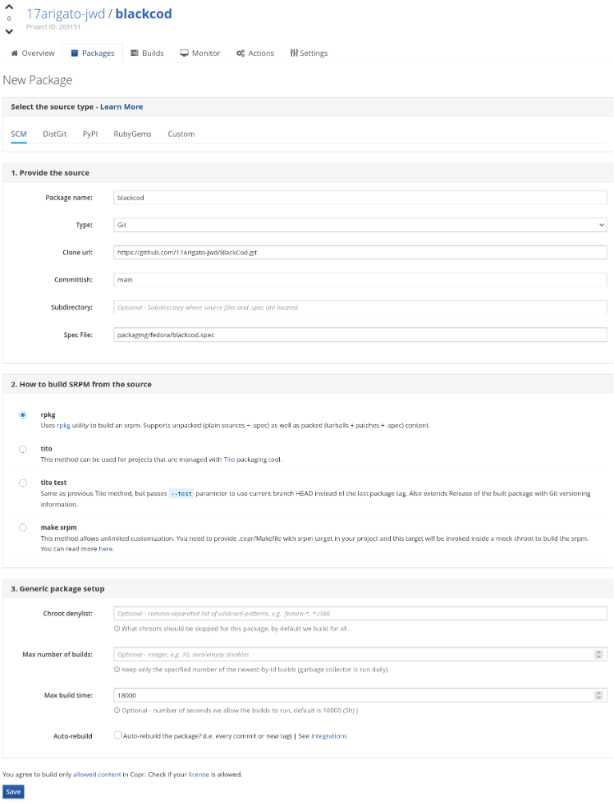
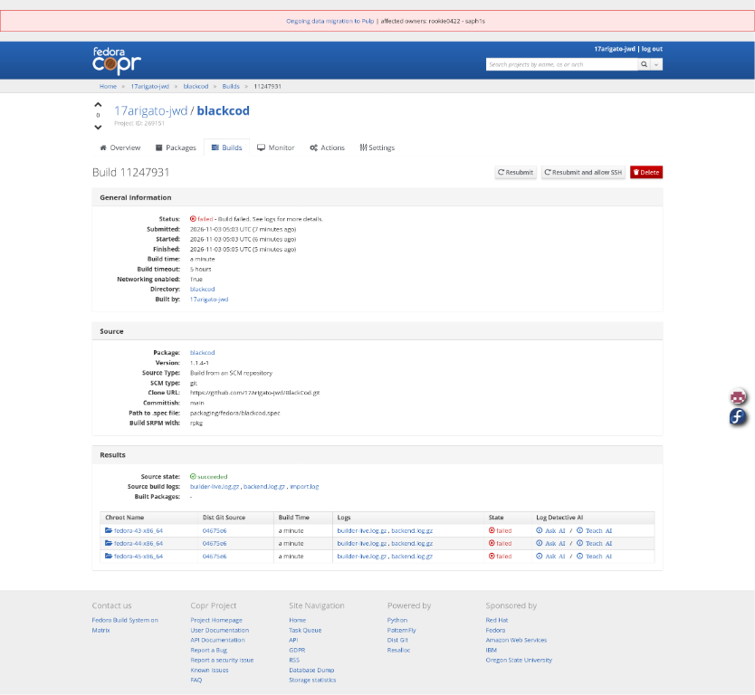

# README.md

<p align="center">

</p>

<h1 align="center">BlackCod</h1>

<p align="center">
<strong>Your personal, offline video sanctuary.</strong><br />
A high-performance desktop application designed to organize, view, and manage your local media library with a YouTube-inspired experience.
</p>

<p align="center">
  
  
  <a href="assets/LICENSE.txt">
    
  </a>
</p>

---

## 📺 About The Project

**BlackCod** brings the familiar, sleek interface of modern streaming platforms to your local file system. Developed by **VCHS-Studios**, it solves the "cluttered folder" problem by providing a centralized, beautiful, and highly customizable environment to watch your saved videos without needing an internet connection.

### ✨ Key Features

* **Premium UI/UX:** A modern, responsive interface built with TailwindCSS and Lucide Icons for a smooth, intuitive experience.
* **Offline First:** No internet? No problem. All metadata and file references are stored locally via IndexedDB.
* **Advanced File Organization:** Upload individual files or entire folders. Organize your content into custom categories within the app without moving files on your hard drive.
* **Personalization:** Deep customization options to make the player and interface look exactly how you want.
* **Engagement Tracking:** Keep track of your journey with a built-in **History** log and a **Liked Videos** library.
* **Seamless Navigation:** Fast search and filtering to find your content instantly.
* **YouTube-style offline features:** Home recommendations, playlists, a playback queue, autoplay, smart chapters, transcript search, and local captions.
* **Explainable Smart Channels:** Build local channels from tags, folders, titles, ratings, languages, subtitles, and transcript content.
* **Optional local analysis:** Register external model-pack descriptors for future transcription, vision, and audio adapters. Models are not bundled and analysis never requires a network connection.
* **Versioned local data:** Configuration records are migrated into a versioned envelope so future releases can evolve storage safely.
* **Native scan boundary:** Electron exposes a typed, validated directory-scan IPC contract for the ongoing renderer-to-main indexing migration.

---

## 📸 Screenshots

The repository includes screenshots of the Fedora COPR publishing workflow.
There are currently no application UI screenshots checked into the repository,
so this section intentionally does not reference placeholder or missing app
images.

| SCM package configuration | Build results |
| --- | --- |
|  |  |

---

## 🛠️ Built With

BlackCod leverages a modern tech stack to ensure speed, type safety, and a small footprint.

* **Framework:** [Electron](https://www.electronjs.org/) (thin cross-platform desktop shell)
* **Language:** [TypeScript](https://www.typescriptlang.org/) & [React](https://reactjs.org/)
* **Styling:** [TailwindCSS](https://tailwindcss.com/)
* **Icons:** [Lucide React](https://lucide.dev/)
* **Database:** [IndexedDB](https://developer.mozilla.org/en-US/docs/Web/API/IndexedDB_API) (For persistent local storage)

---

## 🚀 Getting Started

### Prerequisites

* **Node.js** (v16.x or higher recommended)
* **npm** or **yarn**

### Installation

1. **Clone the repository**

```bash
git clone https://github.com/17Arigato-jwd/blackcod.git
cd blackcod

```

2. **Install dependencies**

```bash
npm install

```

3. **Run the application (Development)**

```bash
npm run dev

```

4. **Run checks and build for Production**

```bash
npm run typecheck
npm run test
npm run build
npm run build:main
```

### Privacy and storage

BlackCod is designed for local-first use. Video files remain in their original locations. Library metadata, preferences, playlists, analysis jobs, model-pack descriptors, and cached records are stored in browser-managed local storage and IndexedDB. The Electron renderer uses a narrow preload bridge rather than direct Node.js access.

External model packs are opt-in metadata registrations. The current adapter boundary does not download or bundle models; a compatible local runtime must be supplied separately before inference can run. Analysis jobs expose cancellation and resource-budget fields so future providers can remain bounded.

### Fedora COPR

The Fedora download channel for BlackCod is the
[17Arigato-jwd/blackcod COPR repository](https://copr.fedorainfracloud.org/coprs/17Arigato-jwd/blackcod/).
It provides Fedora RPM packages built from source. BlackCod uses the
distribution Electron runtime; on Fedora, Electron is provided through the
Terra repository.

#### Install BlackCod on Fedora

On a supported Fedora system, enable Terra for the Electron runtime, then
enable the BlackCod COPR repository and install BlackCod:

```bash
sudo dnf config-manager addrepo --from-repofile=https://github.com/terrapkg/subatomic-repos/raw/main/terra.repo
sudo dnf install terra-release
sudo dnf copr enable 17Arigato-jwd/blackcod
sudo dnf install blackcod
```

If `dnf copr` is not available, install the COPR command plugin first:

```bash
sudo dnf install 'dnf-command(copr)'
```

If `dnf config-manager` is not available, install its plugin first:

```bash
sudo dnf install 'dnf-command(config-manager)'
```

Terra is a third-party Fedora repository. Review its repository policy and
signing configuration before enabling it. It is required because Fedora's
standard repositories do not currently provide the `electron` runtime needed
by the BlackCod RPM.

Launch it from the application menu or run:

```bash
blackcod
```

The package installs the application launcher, desktop entry, icon, and Fedora
runtime dependencies. Your video files stay on your machine; installing from
COPR does not upload or synchronize your media library.

#### Update, remove, or disable the repository

Update BlackCod with the rest of your Fedora packages:

```bash
sudo dnf upgrade blackcod
```

Remove only the application:

```bash
sudo dnf remove blackcod
```

Disable the BlackCod COPR repository:

```bash
sudo dnf copr disable 17Arigato-jwd/blackcod
```

To inspect whether the repository is enabled:

```bash
dnf repolist | grep -i blackcod
```

#### COPR maintainer notes

The package is built from the Git repository using the Fedora spec in
[packaging/fedora](./packaging/fedora). Maintainers should configure the SCM
package with:

| Field | Value |
| --- | --- |
| Git repository | `https://github.com/17Arigato-jwd/BlackCod.git` |
| Branch/committish | `main` |
| Spec file | `packaging/fedora/blackcod.spec` |
| Build method | `rpkg` |

COPR builds the commit visible on the configured branch. Publish changes
before rebuilding:

```bash
git add -A
git commit -m "Describe the change"
git push origin main
```

The build requires internet access because the spec runs `npm ci`. Detailed
packaging notes and troubleshooting are in
[packaging/fedora/README.md](./packaging/fedora/README.md).

The RPM declares `Requires: electron`. COPR can build the package without
resolving runtime dependencies, but end-user installation needs the Terra
repository enabled as shown above.

For maintainers, common build issues include:

- **Missing `blackcod-*.tar.gz`:** ensure the SCM package uses the current
  `packaging/fedora/blackcod.spec`, whose `Source0` points to the GitHub
  archive.
- **Missing build-id for esbuild:** ensure the spec runs
  `npm prune --omit=dev` after the build and before `%install`.
- **Empty debugsource file list:** ensure the spec contains
  `%global debug_package %{nil}`.
- **Build uses old behavior:** verify the packaging commits were pushed to
  GitHub before rebuilding.

---

## 📂 Project Structure

```text
BlackCod/
├── assets/             # Media, logo, and LICENSE.txt
├── components/         # Reusable React components
├── hooks/              # Custom React logic/hooks
├── input/              # Input handling or data entry logic
├── utils/              # Helper functions and utilities
├── App.tsx             # Main React application component
├── index.html          # Entry point for the web/renderer
├── index.tsx           # React DOM mounting script
├── main.ts             # Electron main process entry point
├── forge.config.cjs    # Electron Forge configuration
├── vite.config.ts      # Vite bundler configuration
├── types.ts            # TypeScript interfaces/types
└── metadata.json       # Project metadata and info

```

---

## 📝 Roadmap & Future Updates

* [x] Subtitle (SRT/VTT) parsing, sidecars, captions, and caption controls.
* [x] Custom playlists, playback queue, autoplay, and Home dashboard sections.
* [x] Picture-in-Picture mode and smart chapters.
* [x] Explainable Smart Channels and local analysis job scheduling.
* [ ] Add a concrete optional Whisper-compatible local inference runtime.
* [ ] Move long-running indexing fully into a native background service.
* [ ] Add broader packaging, performance, and end-to-end coverage.
* [ ] Add migrations for IndexedDB analysis, playlist, and library records.

---

## 🤝 Contributing

Contributions are what make the open-source community such an amazing place to learn, inspire, and create.

1. Fork the Project.
2. Create your Feature Branch (`git checkout -b feature/AmazingFeature`).
3. Commit your Changes (`git commit -m 'Add some AmazingFeature'`).
4. Push to the Branch (`git push origin feature/AmazingFeature`).
5. Open a Pull Request.

---

## 📄 License

Distributed under a Custom License. See [LICENSE.txt](https://www.google.com/search?q=assets/LICENSE.txt) for more information.

---

<p align="center">
Created with ❤️ by <strong>17Arigato-jwd</strong> @ <strong>VCHS-Studios</strong>
</p>

---
